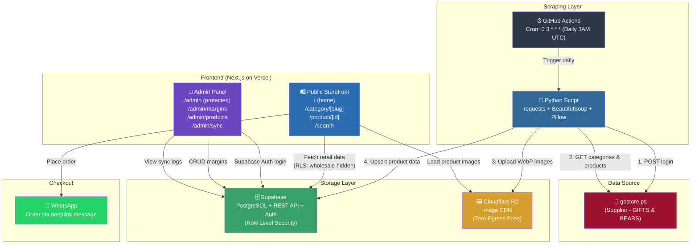
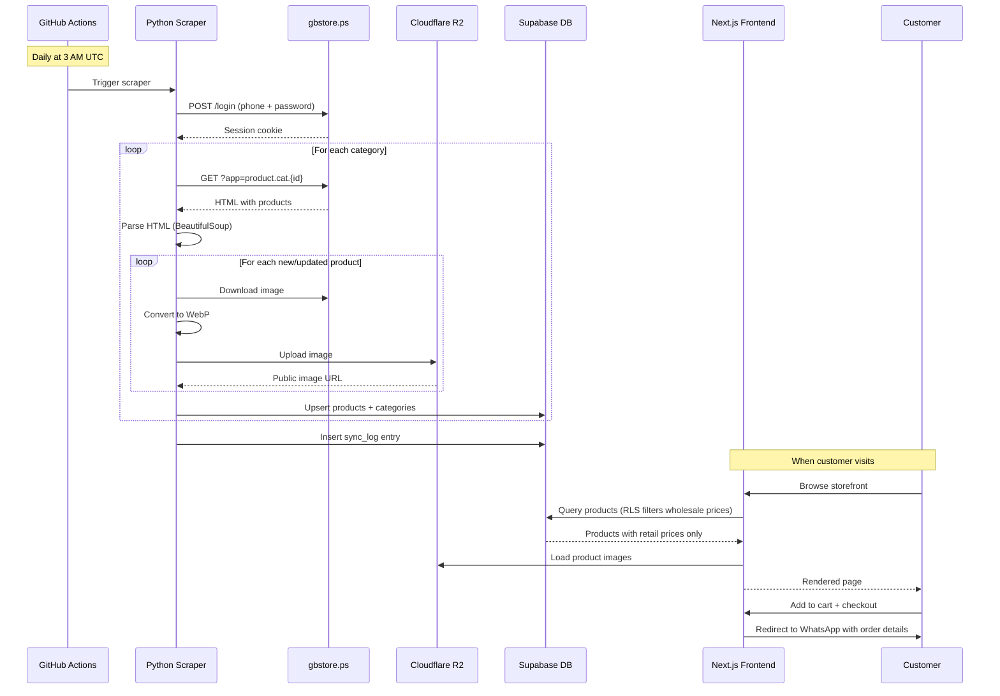
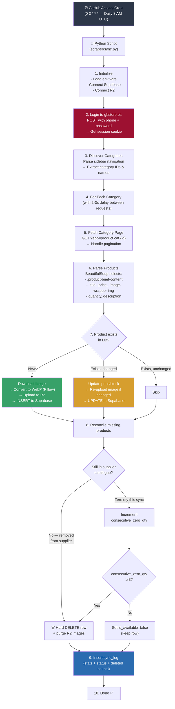
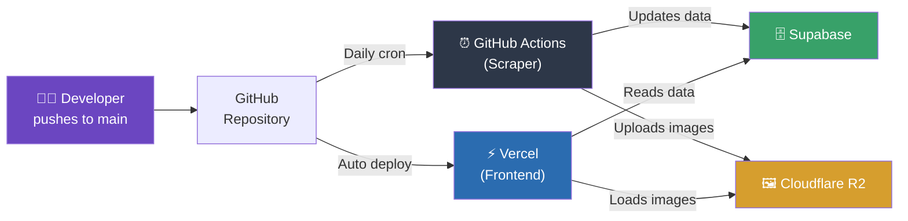

# GB Store — Complete Implementation Plan
### Custom B2B2C E-Commerce Storefront

**Date:** June 28, 2026
**Status:** ✅ Approved — Ready for Implementation

---

## Table of Contents
1. [Project Overview](#1-project-overview)
2. [Architectural Decisions](#2-architectural-decisions)
3. [Live Testing Results](#3-live-testing-results)
4. [Final Technology Stack](#4-final-technology-stack)
5. [System Architecture](#5-system-architecture)
6. [Database Schema](#6-database-schema)
7. [Scraper Design](#7-scraper-design)
8. [Frontend Structure](#8-frontend-structure)
9. [Admin Panel](#9-admin-panel)
10. [Deployment & CI/CD](#10-deployment--cicd)
11. [Cost Summary](#11-cost-summary)
12. [Implementation Phases](#12-implementation-phases)

---

## 1. Project Overview

### Business Goal
Build a custom B2B2C e-commerce storefront that:
- **Scrapes** wholesale product data (prices, images, categories, stock) from the supplier website ([gbstore.ps](https://gbstore.ps)) every 24 hours
- **Applies** dynamic category-based profit margins set by the store admin
- **Displays** only final retail prices to end-consumers (wholesale prices must remain hidden)
- **Redirects** customers to WhatsApp for checkout (no payment gateway needed)

### Core SRS Requirements
| Requirement | Description |
|---|---|
| REQ-3.1.1 | Authenticate with supplier using stored credentials |
| REQ-3.1.2 | Sync every 24 hours |
| REQ-3.1.3 | Extract: Name, Images, Description, Category, Quantity, Wholesale Price |
| REQ-3.1.4 | Compare + diff data (update/insert/deactivate) |
| REQ-3.2.1 | Admin controls for category-based markup (fixed or percentage) |
| REQ-3.2.2 | Retail price = Wholesale price + Category markup |
| REQ-3.2.3 | Margin changes apply immediately (no re-sync needed) |
| REQ-3.3.1 | Products organized by categories |
| REQ-3.3.2 | **Wholesale prices must be completely hidden from customers** |
| NFR-4.1.1 | Scraper must implement pacing delays |
| NFR-4.1.2 | Credentials stored securely |
| NFR-4.1.3 | Minimize storage overhead (reference external assets where appropriate) |

### User Roles
| Role | Access |
|---|---|
| **Customer** | Public storefront, no login required, orders via WhatsApp |
| **Admin (Store Owner)** | Protected admin panel — manage margins, monitor sync status |
| **Automated Sync** | Background scraper running on schedule |

---

## 2. Architectural Decisions

### Dilemma 1: Database vs. JSON (Serverless Approach)

**Proposal:** Build a pure frontend React app reading from a static `data.json` file.

#### Pros
- Zero hosting cost — deploy on GitHub Pages/Netlify/Vercel
- Zero database maintenance — no schema, no backups
- CDN-cached globally

#### Cons
| Risk | Severity | Detail |
|---|---|---|
| Wholesale price exposure | 🔴 Critical | JSON file is publicly accessible — **violates REQ-3.3.2** |
| No admin panel backend | 🟠 High | Can't persist margin changes without a backend |
| No real-time stock accuracy | 🟠 High | 24h stale JSON means out-of-stock products still shown |
| Client-side search limitations | 🟡 Medium | Slow full-text search over large JSON |

#### Verdict: ⛔ NOT RECOMMENDED
The JSON approach fundamentally violates the core security requirement (REQ-3.3.2). Wholesale prices in a publicly accessible JSON file are visible to anyone.

#### Chosen Solution: **Supabase** (Free PostgreSQL + REST API + Auth)
- Row Level Security (RLS) ensures wholesale prices are **never exposed** to public API queries
- Auto-generated REST API eliminates the need to build a custom backend
- Built-in auth for admin panel
- Free tier: 500MB DB, 1GB storage, 50K MAU

---

### Dilemma 2: Image Storage (Hotlinking vs. Download)

**Proposal:** Store original image URLs from `gbstore.ps` and render directly (hotlinking).

#### Pros
- Zero storage cost
- Always up-to-date images
- Zero implementation effort

#### Cons
| Risk | Severity | Detail |
|---|---|---|
| Referer-based blocking | 🔴 Critical | Supplier can block requests from your domain trivially |
| Broken images | 🔴 Critical | Supplier restructures URLs → all images break |
| Performance dependency | 🟠 High | Your store speed chained to supplier's server |
| Legal risk | 🟠 High | Consuming supplier's bandwidth without consent |
| No image optimization | 🟡 Medium | Can't serve WebP, resize for mobile, etc. |

#### Verdict: ⛔ NOT RECOMMENDED
Hotlinking creates an unacceptable single point of failure. The supplier can block it at any time with a single server rule.

#### Chosen Solution: **Cloudflare R2** (Free Image CDN)
- 10GB free storage, 10M reads/month
- **$0 egress fees** (this is the killer feature — no bandwidth charges ever)
- Scraper downloads images → converts to WebP → uploads to R2
- Full control over image pipeline, optimization, and availability

---

### Dilemma 3: Data Extraction Method

**Proposal:** Determine the most reliable, cost-effective scraping approach.

#### Option A: Browser Automation (Playwright/Selenium) — ❌ REJECTED
- Overkill — live testing proved the site is SSR with no anti-bot protections
- Higher compute cost (headless Chrome), slower, less reliable

#### Option B: HTTP Client (requests + BeautifulSoup) — ✅ CHOSEN
- Proven viable via live testing
- ~100 lines of Python, runs in <30 seconds
- Deterministic, lightweight, no rendering engine needed

#### Hosting: **GitHub Actions** (Free Cron)
- 2,000 free minutes/month
- Built-in cron scheduling, secrets management
- Zero infrastructure to maintain

---

### Dilemma 4: Frontend Framework

#### Chosen: **Next.js (App Router) on Vercel**
- Server-side rendering for SEO
- API routes can proxy Supabase calls (extra security layer)
- Free Vercel hosting with automatic deployments
- Admin panel as protected `/admin` route within the same app

---

## 3. Live Testing Results

### Target: [gbstore.ps](https://gbstore.ps) ("GIFTS & BEARS")

### Login Page Analysis


| Aspect | Finding |
|---|---|
| **CMS** | Digital Life CMS 254 (custom PHP-based) |
| **Rendering** | 100% Server-Side Rendered (SSR) |
| **URL Structure** | Query-parameter routing: `?app=product.cat.39`, `?app=product.show.3894` |
| **Login Mechanism** | Standard HTML form POST — fields: `#phone` + `#password` |
| **Session Management** | PHP cookie-based sessions (PHPSESSID-style) |
| **Anti-bot Protections** | ❌ None — no CAPTCHA, no Cloudflare, no rate-limiting |
| **Language** | Arabic (RTL), font: Almarai |
| **Form Fields** | `رقم الجوال` (Phone Number) + `كلمة المرور` (Password) |

### Price Visibility (Logged In vs. Out)


| State | What's Visible | Example |
|---|---|---|
| **Logged Out** | Retail price only | `170 ₪` |
| **Logged In** (wholesale) | Wholesale + struck-through retail | `125 ₪` wholesale, ~~`170 ₪`~~ retail |

- Products tagged with **"جملة"** (wholesale) badge when logged in
- Both prices are in the DOM and trivially extractable via CSS selectors

### Key DOM Structure Observations
- **Product cards:** `.product-brief-content` containers
- **Product titles:** `.title` or `.title h2` within product cards
- **Price elements:** `.price` with nested `<del>` for original and text for wholesale
- **Images:** `.image-wrapper img` with `src` pointing to `/upload/...` paths
- **Categories:** Sidebar navigation with links to `?app=product.cat.{id}`
- **Pagination:** Standard page links if category has many products

### Scraping Feasibility: ✅ CONFIRMED
```python
# This approach is PROVEN VIABLE from live testing:
import requests
from bs4 import BeautifulSoup

session = requests.Session()
session.post('https://gbstore.ps/?account=login', data={
    'phone': '0595809023',
    'password': '112211'
})

# All product data is in the HTML — no JS needed
response = session.get('https://gbstore.ps/?app=product.cat.39')
soup = BeautifulSoup(response.text, 'html.parser')
products = soup.select('.product-brief-content')
```

---

## 4. Final Technology Stack

| Layer | Technology | Cost | Purpose |
|---|---|---|---|
| **Frontend** | Next.js 15 (App Router) | $0 (Vercel free) | Storefront + Admin panel |
| **Database** | Supabase (PostgreSQL) | $0 (free tier) | Products, categories, margins, auth |
| **Image CDN** | Cloudflare R2 | $0 (free tier) | Optimized product images (WebP) |
| **Scraper** | Python (requests + BeautifulSoup) | $0 | Data extraction from supplier |
| **Scraper Host** | GitHub Actions | $0 (free tier) | Daily cron job execution |
| **Auth** | Supabase Auth | $0 (included) | Admin panel authentication |
| **Checkout** | WhatsApp deeplink | $0 | Order submission via WhatsApp message |
| **Version Control** | GitHub | $0 | Source code + CI/CD |

---

## 5. System Architecture



### Data Flow — Step by Step



---

## 6. Database Schema

### Tables

#### `categories`
```sql
CREATE TABLE categories (
    id UUID DEFAULT gen_random_uuid() PRIMARY KEY,
    supplier_id TEXT UNIQUE NOT NULL,       -- Original ID from gbstore.ps (e.g., "39")
    name TEXT NOT NULL,                      -- Arabic category name
    slug TEXT UNIQUE NOT NULL,               -- URL-friendly slug
    image_url TEXT,                           -- R2 image URL
    parent_id UUID REFERENCES categories(id),-- For sub-categories
    sort_order INT DEFAULT 0,
    is_active BOOLEAN DEFAULT true,
    created_at TIMESTAMPTZ DEFAULT now(),
    updated_at TIMESTAMPTZ DEFAULT now()
);
```

#### `products`
```sql
CREATE TABLE products (
    id UUID DEFAULT gen_random_uuid() PRIMARY KEY,
    supplier_id TEXT UNIQUE NOT NULL,        -- Original product ID from supplier
    category_id UUID REFERENCES categories(id),
    name TEXT NOT NULL,
    slug TEXT UNIQUE NOT NULL,
    description TEXT,
    wholesale_price DECIMAL(10,2) NOT NULL,  -- 🔒 HIDDEN via RLS
    image_url TEXT,                           -- R2 CDN URL (WebP)
    additional_images TEXT[],                 -- Array of R2 URLs
    supplier_image_url TEXT,                  -- Original URL for reference
    quantity INT DEFAULT 0,
    consecutive_zero_qty INT DEFAULT 0,      -- 🗑️ Incremented each sync with qty=0; deleted at threshold
    is_available BOOLEAN DEFAULT true,
    is_active BOOLEAN DEFAULT true,          -- Admin can deactivate
    tags TEXT[],                              -- "جملة", "حصرياً", etc.
    created_at TIMESTAMPTZ DEFAULT now(),
    updated_at TIMESTAMPTZ DEFAULT now()
);
```

#### `margins`
```sql
CREATE TABLE margins (
    id UUID DEFAULT gen_random_uuid() PRIMARY KEY,
    category_id UUID REFERENCES categories(id) UNIQUE NOT NULL,
    margin_type TEXT NOT NULL CHECK (margin_type IN ('percentage', 'fixed')),
    margin_value DECIMAL(10,2) NOT NULL,     -- e.g., 15.00 for 15% or 20.00 for ₪20
    created_at TIMESTAMPTZ DEFAULT now(),
    updated_at TIMESTAMPTZ DEFAULT now()
);
```

#### `sync_logs`
```sql
CREATE TABLE sync_logs (
    id UUID DEFAULT gen_random_uuid() PRIMARY KEY,
    started_at TIMESTAMPTZ NOT NULL,
    completed_at TIMESTAMPTZ,
    status TEXT NOT NULL CHECK (status IN ('running', 'success', 'failed')),
    products_added INT DEFAULT 0,
    products_updated INT DEFAULT 0,
    products_deactivated INT DEFAULT 0,
    products_deleted INT DEFAULT 0,          -- Hard-deleted rows (removed from supplier or zero-qty threshold)
    images_deleted INT DEFAULT 0,            -- R2 images purged alongside deleted products
    categories_found INT DEFAULT 0,
    error_message TEXT,
    created_at TIMESTAMPTZ DEFAULT now()
);
```

### Database View — Retail Products (Public API)
```sql
-- This view computes retail prices and NEVER exposes wholesale_price
CREATE VIEW public_products AS
SELECT
    p.id,
    p.name,
    p.slug,
    p.description,
    p.image_url,
    p.additional_images,
    p.quantity,
    p.is_available,
    p.tags,
    c.name AS category_name,
    c.slug AS category_slug,
    c.id AS category_id,
    CASE
        WHEN m.margin_type = 'percentage'
            THEN ROUND(p.wholesale_price * (1 + m.margin_value / 100), 2)
        WHEN m.margin_type = 'fixed'
            THEN p.wholesale_price + m.margin_value
        ELSE p.wholesale_price  -- fallback if no margin set
    END AS retail_price,
    p.updated_at
FROM products p
JOIN categories c ON p.category_id = c.id
LEFT JOIN margins m ON c.id = m.category_id
WHERE p.is_active = true AND c.is_active = true;
```

### Row Level Security (RLS)
```sql
-- Enable RLS on products table
ALTER TABLE products ENABLE ROW LEVEL SECURITY;

-- Public users can ONLY read via the public_products view (no wholesale_price)
CREATE POLICY "Public read products" ON products
    FOR SELECT TO anon
    USING (is_active = true);

-- But the anon role CANNOT see wholesale_price column directly
-- Enforce this by granting SELECT only on specific columns:
REVOKE ALL ON products FROM anon;
GRANT SELECT (id, name, slug, description, image_url, additional_images,
              quantity, is_available, is_active, tags, category_id,
              created_at, updated_at) ON products TO anon;

-- Admin (authenticated) can see everything including wholesale_price
CREATE POLICY "Admin full access" ON products
    FOR ALL TO authenticated
    USING (true)
    WITH CHECK (true);

-- Margins: only admin can read/write
ALTER TABLE margins ENABLE ROW LEVEL SECURITY;
CREATE POLICY "Admin manage margins" ON margins
    FOR ALL TO authenticated
    USING (true) WITH CHECK (true);

-- Sync logs: only admin can read, scraper writes via service_role key
ALTER TABLE sync_logs ENABLE ROW LEVEL SECURITY;
CREATE POLICY "Admin read sync logs" ON sync_logs
    FOR SELECT TO authenticated
    USING (true);
```

---

## 7. Scraper Design

### Architecture



### Project Structure — Scraper
```
scraper/
├── sync.py              # Main entry point
├── auth.py              # Login session management
├── extractor.py         # HTML parsing (categories + products)
├── image_pipeline.py    # Download → WebP → R2 upload
├── db.py                # Supabase upsert logic
├── config.py            # Environment variable loader
├── requirements.txt     # requests, beautifulsoup4, pillow, supabase, boto3
└── README.md            # Setup instructions
```

### Key Implementation Details

1. **Pacing (NFR-4.1.1):** `time.sleep(random.uniform(2, 4))` between requests
2. **Credentials (NFR-4.1.2):** Stored as GitHub Actions encrypted secrets
3. **Image Optimization:** Pillow converts to WebP at 80% quality (~60-70% size reduction)
4. **Diff Logic:** Compare `wholesale_price`, `quantity`, `name` against existing DB records
5. **Error Handling:** Try/except per product, continue on failure, log errors in `sync_logs`
6. **Cleanup (NFR-4.1.3 — Minimize Storage):** Two-tier deletion strategy:
   - **Hard delete immediately:** Products no longer present in the supplier catalogue → `DELETE FROM products WHERE supplier_id = ?` + delete R2 image objects
   - **Hard delete after threshold:** Products with `quantity = 0` for 3 consecutive syncs → `consecutive_zero_qty` is incremented each sync; when `>= 3`, the row is hard-deleted and R2 images purged
   - **Intermediate state:** Products with `quantity = 0` but `consecutive_zero_qty < 3` → `is_available = false` (hidden from storefront, kept in DB)
   - **R2 cleanup:** Before deleting a DB row, the scraper calls R2 `delete_objects` for `image_url` and all entries in `additional_images[]` to prevent orphaned files

### Cleanup Strategy — Decision Matrix

| Scenario | Action | Storage Impact |
|---|---|---|
| Product removed from supplier site | Hard DELETE row + purge R2 images | ✅ Full cleanup |
| `quantity = 0` for 1–2 syncs | `is_available = false`, row kept | 🟡 Temporarily retained |
| `quantity = 0` for 3+ consecutive syncs | Hard DELETE row + purge R2 images | ✅ Full cleanup |
| Product back in stock after zero-qty | Reset `consecutive_zero_qty = 0`, `is_available = true` | — |
| Admin manually deactivated (`is_active = false`) | Row kept indefinitely (admin intent) | 🟡 Admin-controlled |

> [!NOTE]
> The 3-sync threshold (~72 hours) gives a buffer for genuine temporary stock-outs at the supplier before permanently purging. This value can be adjusted via a config env var (`ZERO_QTY_DELETE_THRESHOLD`, default `3`).

### GitHub Actions Workflow
```yaml
# .github/workflows/scrape.yml
name: Daily Product Sync
on:
  schedule:
    - cron: '0 3 * * *'      # Daily at 3 AM UTC
  workflow_dispatch:            # Manual trigger button

jobs:
  sync:
    runs-on: ubuntu-latest
    timeout-minutes: 30
    steps:
      - uses: actions/checkout@v4
      - uses: actions/setup-python@v5
        with:
          python-version: '3.12'

      - name: Install dependencies
        run: pip install -r scraper/requirements.txt

      - name: Run product sync
        run: python scraper/sync.py
        env:
          SUPPLIER_PHONE: ${{ secrets.SUPPLIER_PHONE }}
          SUPPLIER_PASSWORD: ${{ secrets.SUPPLIER_PASSWORD }}
          SUPABASE_URL: ${{ secrets.SUPABASE_URL }}
          SUPABASE_SERVICE_KEY: ${{ secrets.SUPABASE_SERVICE_KEY }}
          R2_ENDPOINT: ${{ secrets.R2_ENDPOINT }}
          R2_ACCESS_KEY: ${{ secrets.R2_ACCESS_KEY }}
          R2_SECRET_KEY: ${{ secrets.R2_SECRET_KEY }}
          R2_BUCKET: ${{ secrets.R2_BUCKET }}
```

---

## 8. Frontend Structure

### Next.js App Router Structure
```
src/
├── app/
│   ├── layout.js              # Root layout (RTL, Arabic font, global nav)
│   ├── page.js                # Homepage — hero + featured categories + new products
│   ├── globals.css            # Design system (CSS variables, typography, components)
│   │
│   ├── category/
│   │   └── [slug]/
│   │       └── page.js        # Category listing — product grid + filters + sort
│   │
│   ├── product/
│   │   └── [slug]/
│   │       └── page.js        # Product detail — images, description, price, WhatsApp CTA
│   │
│   ├── search/
│   │   └── page.js            # Search results page
│   │
│   ├── admin/
│   │   ├── layout.js          # Admin layout (auth guard, sidebar nav)
│   │   ├── page.js            # Dashboard — sync status, product counts, quick stats
│   │   ├── margins/
│   │   │   └── page.js        # Category margin management (table + inline edit)
│   │   ├── products/
│   │   │   └── page.js        # Product overview (wholesale + retail prices visible)
│   │   └── login/
│   │       └── page.js        # Admin login page
│   │
│   └── api/                   # API routes (optional middleware)
│       └── ...
│
├── components/
│   ├── layout/
│   │   ├── Header.jsx         # Site header with logo, search, nav
│   │   ├── Footer.jsx         # Site footer
│   │   ├── Sidebar.jsx        # Category sidebar navigation
│   │   └── MobileNav.jsx      # Mobile hamburger menu
│   │
│   ├── product/
│   │   ├── ProductCard.jsx    # Product card for grid listings
│   │   ├── ProductGrid.jsx    # Responsive product grid
│   │   ├── ProductDetail.jsx  # Full product detail view
│   │   └── PriceTag.jsx       # Formatted price display (₪)
│   │
│   ├── category/
│   │   ├── CategoryCard.jsx   # Category card for homepage grid
│   │   └── CategoryGrid.jsx   # Category grid layout
│   │
│   ├── checkout/
│   │   └── WhatsAppButton.jsx # WhatsApp order CTA with pre-filled message
│   │
│   ├── search/
│   │   ├── SearchBar.jsx      # Header search input
│   │   └── SearchResults.jsx  # Search results display
│   │
│   └── ui/
│       ├── LoadingSpinner.jsx
│       ├── Badge.jsx
│       ├── EmptyState.jsx
│       └── Breadcrumb.jsx
│
├── lib/
│   ├── supabase.js            # Supabase client initialization
│   ├── supabase-server.js     # Server-side Supabase client
│   ├── utils.js               # Helpers (slug generation, price formatting)
│   └── whatsapp.js            # WhatsApp deeplink generator
│
└── public/
    ├── fonts/                 # Almarai font (self-hosted)
    └── icons/                 # Favicons, PWA icons
```

### Design System Highlights
- **Direction:** RTL (Arabic-first)
- **Typography:** Almarai (Google Fonts, self-hosted for performance)
- **Color Palette:** Premium dark theme with the supplier's accent (#9d1131 crimson) reimagined
- **Animations:** Subtle micro-animations on cards, hover effects, page transitions
- **Responsive:** Mobile-first, 3 breakpoints (mobile, tablet, desktop)
- **Accessibility:** Semantic HTML5, proper heading hierarchy, alt text on images

### WhatsApp Checkout Flow
```
Customer adds items → Cart summary displayed →
Click "اطلب عبر واتساب" (Order via WhatsApp) →
Opens WhatsApp with pre-filled message:

"مرحباً، أريد طلب المنتجات التالية:
1. شنطة FENDI × 1 — 130 ₪
2. عطر CK × 2 — 90 ₪
المجموع: 310 ₪
شكراً!"
```

---

## 9. Admin Panel

### Features
| Feature | Route | Description |
|---|---|---|
| **Login** | `/admin/login` | Supabase Auth (email/password) |
| **Dashboard** | `/admin` | Last sync time, product counts, error alerts |
| **Margins** | `/admin/margins` | Table of categories with inline margin editing |
| **Products** | `/admin/products` | Full product table showing wholesale + retail + margin |
| **Sync Logs** | `/admin` (dashboard widget) | History of sync runs with status and stats |

### Margin Management UI
```
┌─────────────────────────────────────────────────────────────┐
│  Category Margins                                    [Save All] │
├──────────────────┬──────────┬──────────┬──────────────────┤
│ Category         │ Type     │ Value    │ Example          │
├──────────────────┼──────────┼──────────┼──────────────────┤
│ شنط و جزادين    │ [% ▼]    │ [15    ] │ 100₪ → 115₪    │
│ عطور            │ [Fixed ▼]│ [20    ] │ 70₪ → 90₪      │
│ ساعات ستاتية    │ [% ▼]    │ [25    ] │ 200₪ → 250₪    │
│ اكسسوار         │ [% ▼]    │ [10    ] │ 50₪ → 55₪      │
└──────────────────┴──────────┴──────────┴──────────────────┘
```

### Auth Protection
- Supabase Auth with email/password (admin creates their account once)
- Next.js middleware checks auth state on all `/admin/*` routes
- Redirects to `/admin/login` if not authenticated
- Service role key used ONLY by the scraper (server-side, never exposed)

---

## 10. Deployment & CI/CD

### GitHub Repository Structure
```
custom-store/
├── .github/
│   └── workflows/
│       └── scrape.yml         # Daily cron scraper
│
├── scraper/                   # Python scraper (separate from frontend)
│   ├── sync.py
│   ├── auth.py
│   ├── extractor.py
│   ├── image_pipeline.py
│   ├── db.py
│   ├── config.py
│   └── requirements.txt
│
├── src/                       # Next.js frontend
│   ├── app/
│   ├── components/
│   ├── lib/
│   └── ...
│
├── public/
├── supabase/
│   └── migrations/
│       └── 001_initial_schema.sql
│
├── .env.local.example         # Template for local dev
├── next.config.js
├── package.json
├── srs.md                     # Original requirements
└── README.md
```

### Deployment Flow


### Required Secrets (GitHub Actions)
| Secret Name | Description |
|---|---|
| `SUPPLIER_PHONE` | gbstore.ps login phone number |
| `SUPPLIER_PASSWORD` | gbstore.ps login password |
| `SUPABASE_URL` | Supabase project URL |
| `SUPABASE_SERVICE_KEY` | Supabase service_role key (full access) |
| `R2_ENDPOINT` | Cloudflare R2 S3-compatible endpoint |
| `R2_ACCESS_KEY` | R2 API access key |
| `R2_SECRET_KEY` | R2 API secret key |
| `R2_BUCKET` | R2 bucket name |

### Environment Variables (Next.js / Vercel)
| Variable | Description | Exposed to Client? |
|---|---|---|
| `NEXT_PUBLIC_SUPABASE_URL` | Supabase project URL | ✅ Yes (public) |
| `NEXT_PUBLIC_SUPABASE_ANON_KEY` | Supabase anon key (RLS-protected) | ✅ Yes (safe with RLS) |
| `SUPABASE_SERVICE_KEY` | Service role key | ❌ Server-only |

---

## 10.5 Phase 6a & 6b Architecture

Phase 6 is split into two focused sub-phases to stay manageable for isolated implementation sessions.

---

## Phase 6a Architecture: Multi-Instance White-Labeling, Brands Scraping, Product Availability Override & Color Variants

### 1. Multi-Instance White-Labeling (Isolated Deployments per Client)

Each client gets a **fully isolated deployment** — their own Supabase project, their own auth, their own margins, their own UI config. The **scraper is the only shared layer**: it writes to a central "source of truth" Supabase project, and each client deployment reads from it or from a copy depending on sensitivity.

#### Architecture Decision — Shared vs. Isolated Data

| Data Layer | Shared? | Why |
|---|---|---|
| `categories` table | ✅ Shared (read-only) | Same supplier, same category structure |
| `products` table (base data: name, images, description) | ✅ Shared (read-only) | Same products from same supplier |
| `wholesale_price` | ✅ Only in shared DB (service key, scraper only) | Never exposed to any client |
| `margins` table | ❌ Isolated per client | Each client has their own markup strategy |
| `is_available` admin override | ❌ Isolated per client | Client controls their own product visibility |
| `color_variant` order tracking | ❌ Isolated per client | Each client has their own order history |
| Supabase Auth (admin users) | ❌ Isolated per client | Each client has their own admin credentials |
| `analytics_visits` | ❌ Isolated per client | Client-specific traffic data |

#### Implementation Strategy
- The **scraper** writes to a single **"master" Supabase project** (base product + category data only, no margins).
- Each **client deployment** is a cloned Next.js repo configured via `.env.local` to point to its own **"client" Supabase project**.
- A lightweight **sync script** (or Supabase foreign data wrapper / Edge Function) copies `categories` and `products` (non-wholesale columns only) from master → client DB on a schedule, or the client reads from master via a restricted view using a scoped API key.
- Client-specific tables (`margins`, `product_availability_overrides`, `analytics_visits`) live **only in the client Supabase project**.

#### Environment Variables per Client Instance
```bash
# Identity
NEXT_PUBLIC_STORE_NAME="Eloria FASHION"
NEXT_PUBLIC_STORE_LOGO_URL="https://..."
NEXT_PUBLIC_WHATSAPP_NUMBER="+972591234567"
NEXT_PUBLIC_PRIMARY_COLOR="#9d1131"

# Client-isolated Supabase project
NEXT_PUBLIC_SUPABASE_URL="https://clientxyz.supabase.co"
NEXT_PUBLIC_SUPABASE_ANON_KEY="..."
SUPABASE_SERVICE_KEY="..."             # Server-only, for admin writes

# Optional: pointer to master DB for shared product data
MASTER_SUPABASE_URL="..."
MASTER_SUPABASE_ANON_KEY="..."
```

> [!IMPORTANT]
> The admin panel (`/admin`) must have **no public link** from the storefront header or footer. Admins access it only via direct URL. This applies to all instances.

---

### 2. Brands Scraping & Multi-Taxonomy

Products on the supplier site may belong to a **brand** (e.g., "Rolex", "FENDI") in addition to a category. Both must be scraped.

#### Database Schema Updates

```sql
-- New: brands table (mirrors structure of categories)
CREATE TABLE brands (
    id UUID DEFAULT gen_random_uuid() PRIMARY KEY,
    supplier_id TEXT UNIQUE NOT NULL,        -- Original brand ID from supplier
    name TEXT NOT NULL,
    slug TEXT UNIQUE NOT NULL,
    image_url TEXT,                           -- R2 CDN URL (brand logo/image)
    is_active BOOLEAN DEFAULT true,
    created_at TIMESTAMPTZ DEFAULT now(),
    updated_at TIMESTAMPTZ DEFAULT now()
);

-- Products can belong to one category AND one brand (or neither brand)
ALTER TABLE products
    ADD COLUMN brand_id UUID REFERENCES brands(id);

-- For many-to-many (if a product belongs to multiple brands/categories):
-- Use product_brands join table instead of brand_id column
CREATE TABLE product_brands (
    product_id UUID REFERENCES products(id) ON DELETE CASCADE,
    brand_id UUID REFERENCES brands(id) ON DELETE CASCADE,
    PRIMARY KEY (product_id, brand_id)
);
```

#### Scraper Updates (`extractor.py`)
- During category discovery, also discover the **brands section** of the supplier site navigation (if present) and extract `brand_id`, `name`, and `image_url`.
- When parsing a product, extract its associated brand tag/badge from the product card HTML.
- Upsert brands into the `brands` table; link products via `brand_id` or `product_brands`.

#### Frontend Updates
- New route: `/brand/[slug]` — product grid filtered by brand, with same sorting options as category pages.
- New route: `/brands` — brands directory page (works even with 0 active products for a brand).
- `BrandsSlider` component on homepage.
- `public_products` view updated to include `brand_name` and `brand_slug`.

---

### 3. Product Availability Override (Admin-Controlled, Isolated per Client)

The admin must be able to **manually mark any product as available or unavailable**, independently of what the supplier's stock says. This is fully isolated per client instance.

#### Why This Exists
- The supplier may show a product as in-stock, but the client's admin doesn't want to sell it (discontinued, quality issue, etc.).
- The supplier may show zero stock temporarily, but the admin knows stock is coming and wants to keep it visible.
- This control is **per-client** and must **never be overwritten** by the scraper sync.

#### Implementation

```sql
-- New table: admin overrides for product availability (client DB only)
CREATE TABLE product_availability_overrides (
    id UUID DEFAULT gen_random_uuid() PRIMARY KEY,
    product_supplier_id TEXT NOT NULL,       -- References supplier_id from products
    is_available BOOLEAN NOT NULL,           -- Admin's explicit override value
    override_reason TEXT,                    -- Optional: reason for the override
    overridden_by TEXT,                      -- Admin user email/id
    created_at TIMESTAMPTZ DEFAULT now(),
    updated_at TIMESTAMPTZ DEFAULT now(),
    UNIQUE(product_supplier_id)
);
```

#### Logic Flow

| Scenario | Supplier Stock | Admin Override | Shown to Customer? |
|---|---|---|---|
| Normal available | in_stock | none | ✅ Yes |
| Normal unavailable | zero/out | none | ❌ No |
| Admin forces available | zero/out | `is_available = true` | ✅ Yes (override) |
| Admin forces unavailable | in_stock | `is_available = false` | ❌ No (override) |

- The **scraper never touches** `product_availability_overrides`.
- The **`public_products` view** must check: `COALESCE(override.is_available, p.is_available)` to respect the admin's intent.
- The **admin panel** (`/admin/products`) gets a toggle per product: **"إتاحة / إخفاء"** (Available / Hidden) with an optional reason field. Override state is visually distinct (e.g., a badge: "Admin Override Active").

---

### 4. Color Variants — Scraping, Display & Order Workflow

Each product can have multiple colors; each color has its own image. The customer must be able to see all colors, select one, and the selected color must be included in the WhatsApp order.

#### Scraper Updates (`extractor.py` + `image_pipeline.py`)

On the product detail page (visited during scraping), extract all color swatches:

```python
# Each color variant scraped as:
{
  "color_id": "supplier-internal-id-or-index",
  "color_name": "أحمر",          # Arabic color name from supplier
  "image_url": "https://r2.../product-123-red.webp",  # Uploaded to R2
  "supplier_image_url": "https://gbstore.ps/upload/...",
  "is_available": True,           # Based on supplier's swatch state (slashed/greyed = False)
}
```

Storage in DB:
```sql
-- color_variants stored as JSONB array on the products table
ALTER TABLE products
    ADD COLUMN color_variants JSONB DEFAULT '[]';

-- Structure of each element in the JSONB array:
-- { "color_id": str, "color_name": str, "image_url": str, "supplier_image_url": str, "is_available": bool }
```

#### Frontend: Product Detail Page (`/product/[slug]`)

- Display a **color swatch row** below the main product image.
- Each swatch = a clickable thumbnail. Clicking it changes the **main product image** to that color's image.
- **Unavailable colors** (scraped as `is_available: false`) are displayed with a diagonal slash overlay or greyed-out with a `غير متوفر` tooltip — not selectable.
- **Selection is required** before adding to cart if the product has multiple colors. If only one color exists, auto-select it.

#### Order Workflow (WhatsApp Checkout)

When the customer sends their cart via WhatsApp, the message includes:

```
مرحباً، أريد طلب المنتجات التالية:
1. شنطة FENDI — اللون: أحمر × 1 — 130 ₪
2. عطر CK — اللون: أزرق × 2 — 90 ₪
المجموع: 310 ₪
شكراً!
```

- If the product has colors, the selected color name is appended in the message.
- The product's selected color image is also included as an image link in the WhatsApp message if technically possible (or referenced as a URL).

---

### Phase 6a Implementation Tasks

```
Phase 6a: Multi-Instance, Brands, Availability Override & Color Variants
```

- [x] **DB Migration (Master)**: Add `brands` table, `product_brands` join table, `brand_id` on `products`, `color_variants JSONB` column on `products`
- [x] **DB Migration (Client)**: Add `product_availability_overrides` table; update `public_products` view to use `COALESCE(override.is_available, p.is_available)`
- [x] **Scraper: Brand Discovery** — `extractor.py`: Discover and extract brands from supplier navigation; upsert to `brands` table; link to products
- [x] **Scraper: Color Variants** — `extractor.py`: Visit product detail page per product; extract all color swatches (name, image URL, availability); upload each color image to R2; store as `color_variants` JSONB
- [x] **Scraper: `db.py` updates** — Handle brand upsert + product→brand linking; handle `color_variants` diff (re-scrape if product updated)
- [x] **Frontend: `/brand/[slug]`** — Brand product grid page with sort selector (Default / Low→High / High→Low)
- [x] **Frontend: `/brands`** — Brands directory page (handles 0 products gracefully)
- [x] **Frontend: `BrandsSlider`** — Homepage horizontal scrolling brands carousel
- [x] **Frontend: Color Swatch UI** — On `/product/[slug]`, show interactive color thumbnails; clicking changes main image; unavailable colors slashed/greyed; selection required before ordering
- [x] **Frontend: WhatsApp message** — Include selected color name in cart order message
- [x] **Admin: Product Availability Override** — Toggle + optional reason field per product in `/admin/products`; visually distinguish "admin override active" state from normal availability
- [x] **Multi-instance `.env.local` template** — Document all per-client env vars; update `README.md` with cloning instructions for new client instances
- [x] **Admin panel link removal** — Remove any public footer/header link to `/admin/login` across all layouts

---

## Phase 6b Architecture: Internationalization, Homepage Polish & Visitor Analytics

### 1. Internationalization (i18n: Arabic, English, Hebrew)

- **Language Support**: Full RTL (`ar`, `he`) and LTR (`en`) layout switching.
- **Translation Strategy**: During scraping, product names and descriptions are translated and stored as separate columns (`name_en`, `name_he`, `description_en`, `description_he`) to avoid runtime translation latency.

```sql
ALTER TABLE products
    ADD COLUMN name_en TEXT,
    ADD COLUMN name_he TEXT,
    ADD COLUMN description_en TEXT,
    ADD COLUMN description_he TEXT;

ALTER TABLE categories
    ADD COLUMN name_en TEXT,
    ADD COLUMN name_he TEXT;

ALTER TABLE brands
    ADD COLUMN name_en TEXT,
    ADD COLUMN name_he TEXT;
```

- **URL Strategy**: Locale-prefixed routes (`/ar/...`, `/en/...`, `/he/...`) using Next.js built-in i18n routing.
- **UI Localization**: Language switcher (`AR / EN / HE`) in the site header. User's preference stored in a cookie or `localStorage`.
- **Direction**: `dir="rtl"` for Arabic and Hebrew, `dir="ltr"` for English — applied at the `<html>` level per locale.

### 2. Homepage UI Polish & Sliders

- **`CategoriesSlider`**: Replace static category grid on homepage with a smooth horizontal scroll slider (mobile swipeable, desktop arrow-navigated).
- **`BrandsSlider`**: Same treatment for brands section on homepage.
- **Smart CTA visibility**: In homepage category showcase sections, hide the **"عرض كل منتجات القسم ←"** button automatically when the section has ≤ 4 products (all items already visible, button is redundant).
- **General homepage refresh**: Review spacing, typography scale, hero banner content.

### 3. Visitor Analytics Dashboard

```sql
-- Track anonymous site visits (client DB only)
CREATE TABLE analytics_visits (
    id UUID DEFAULT gen_random_uuid() PRIMARY KEY,
    session_id TEXT NOT NULL,               -- Anonymous session fingerprint (no PII)
    page_path TEXT NOT NULL,                -- e.g., "/", "/category/handbags", "/product/fendi-bag"
    referrer TEXT,
    user_agent TEXT,
    visited_at TIMESTAMPTZ DEFAULT now()
);
```

- **Admin Dashboard widget**: Interactive visit charts filtered by day / week / month.
- **Data collection**: Lightweight client-side beacon (no third-party analytics needed).
- **Privacy**: No PII collected — session ID is a random anonymous token stored in `sessionStorage`.

### Phase 6b Implementation Tasks

> [!CAUTION]
> **HIGH PRIORITY TASK (FIRST THING TO BE DONE)**: The scraper currently takes 12+ hours to complete after adding brands and color variant extraction in Phase 6a (previously ~2 hours). We must audit and fix this performance bottleneck before proceeding with other tasks.

- [x] **CRITICAL: Scraper Performance & 12-Hour Bug Fix** — Audit why `sync.py` takes 12+ hours. Implement optimizations: skip detail page scraping when product/swatches haven't changed, add request concurrency/asyncio, optimize HTTP session reuse, and reduce redundant R2 image checks/uploads.
- [ ] **DB Migration**: Add multilingual columns (`name_en`, `name_he`, etc.) to `products`, `categories`, `brands`; add `analytics_visits` table
- [x] **Scraper: Translation & Retries** — On product insert/update, populate translations; implement 3-try retry mechanism with backoff for failed image downloads and network requests
- [ ] **Next.js i18n config** — Set up locale routing (`/ar`, `/en`, `/he`); configure `dir` attribute per locale in root layout
- [ ] **Translation context** — React context or hook (`useTranslation`) to serve the correct locale's strings throughout the app
- [ ] **Language switcher component** — Header `AR / EN / HE` toggle; persists preference to cookie; redirects to locale-prefixed URL
- [ ] **All UI strings localized** — Replace hardcoded Arabic strings with translation keys across all pages and components
- [ ] **`CategoriesSlider`** — Horizontal scroll carousel for categories on homepage
- [x] **`BrandsSlider`** — Horizontal scroll carousel for brands on homepage
- [ ] **Smart CTA hide logic** — Conditionally render "عرض كل منتجات القسم" only when section has > 4 products
- [ ] **`analytics_visits` beacon** — Lightweight visit tracker (page path + session ID) fired on route change
- [ ] **Admin: Visitor Analytics Dashboard** — Charts (line/bar) with day/week/month filters in `/admin`

---

## Phase 6c: Shared Database Multi-Tenancy (`store_id` Client Isolation)

### Goal
Allow multiple client e-commerce websites (e.g. Client A, Client B) to connect to the **same shared Supabase database** (sharing the scraped `products`, `categories`, `brands`, `images`), while keeping **price margins**, **availability overrides**, and **admin authentication** completely isolated per client instance.

### User Review Required

> [!IMPORTANT]
> **Database Architecture**: We will introduce a `store_id` column to `price_margins` and `product_availability_overrides`. The shared catalog (`products`, `categories`, `brands`) remains read-only for client apps and has no `store_id`.

> [!IMPORTANT]
> **Dynamic Product View via RPC**: Since standard PostgreSQL views cannot accept runtime parameters like `store_id` in joins, we will replace the static `public_products` view with a table-valued PostgreSQL function `get_public_products(p_store_id text DEFAULT 'default')`.

> [!IMPORTANT]
> **Environment Configuration**: Each client instance will define `NEXT_PUBLIC_STORE_ID="store_name"` in their `.env.local`. For this client, we will set `NEXT_PUBLIC_STORE_ID="eloria"` along with their branding variables.

### Proposed Changes

#### Database Schema & RPC
- Create migration `003_phase6c_client_isolation.sql`:
  - Add `store_id TEXT NOT NULL DEFAULT 'default'` to `price_margins` and `product_availability_overrides`.
  - Update unique/primary constraints to composite keys: `UNIQUE(store_id, category_id)` and `PRIMARY KEY (store_id, product_supplier_id)`.
  - Create function `get_public_products(p_store_id text DEFAULT 'default')` returning `SETOF products` joined with store-specific margins and overrides.

#### Backend Queries & API
- **[MODIFY] [queries.js](file:///c:/Users/AhmedAlawneh/Desktop/custom-store/src/lib/queries.js)**:
  - Define `const STORE_ID = process.env.NEXT_PUBLIC_STORE_ID || 'default';`.
  - Update all public queries (`getProducts`, `getProductsForCategory`, `getProductsForBrand`, `getProductById`, `searchProducts`) to query `supabase.rpc('get_public_products', { p_store_id: STORE_ID })`.
  - Update admin queries (`getAvailabilityOverrides`, `upsertAvailabilityOverride`, `deleteAvailabilityOverride`, `getMarginsWithCategories`, `upsertMargin`) to scope by `STORE_ID`.

#### Admin UI & API Routes
- **[MODIFY] [availability/route.js](file:///c:/Users/AhmedAlawneh/Desktop/custom-store/src/app/api/admin/availability/route.js)** & **[margins/route.js](file:///c:/Users/AhmedAlawneh/Desktop/custom-store/src/app/api/admin/margins/route.js)**: Pass `STORE_ID` when saving or reverting.
- **[MODIFY] [admin/products/page.js](file:///c:/Users/AhmedAlawneh/Desktop/custom-store/src/app/admin/products/page.js)** & **[admin/margins/page.js](file:///c:/Users/AhmedAlawneh/Desktop/custom-store/src/app/admin/margins/page.js)**: Load only data belonging to `STORE_ID`.

#### Environment Configuration
- **[MODIFY] [.env.local](file:///c:/Users/AhmedAlawneh/Desktop/custom-store/.env.local)** & **[.env.local.example](file:///c:/Users/AhmedAlawneh/Desktop/custom-store/.env.local.example)**:
  - Add `NEXT_PUBLIC_STORE_ID="eloria"` (and `"default"` in example).

### Verification Plan

#### Automated Tests
- Run `npm run build` to verify TypeScript and Next.js Turbopack compilation.

#### Manual Verification
- Execute `003_phase6c_client_isolation.sql` in Supabase SQL Editor.
- Verify in SQL Editor that calling `get_public_products('eloria')` vs `get_public_products('other_store')` returns isolated prices and availability overrides.
- Test toggling availability and setting margins in `/admin` and confirm changes only apply to the current `STORE_ID`.

---

## Phase 6d: Multi-Supplier Architecture & Catalog Switching

### Goal
Support multiple suppliers (e.g. `gbstore`, `shoes_store`, etc.) sharing the exact same scraper architecture and e-commerce template, while keeping their catalogs completely separated in the shared database. Allow each client website instance to configure which suppliers they support (via `.env`) and provide an intuitive storefront toggle for customers to switch between supported supplier catalogs without exposing raw supplier names.

### User Review Required

> [!IMPORTANT]
> **Database Architecture**: We will add a `supplier_code` column (e.g., `'gb'`, `'shoes'`) to `products`, `categories`, and `brands`. This prevents mixing or overwriting items from different suppliers that happen to have similar brand/category names.

> [!IMPORTANT]
> **Scraper Extensibility**: The Python scraper will be updated to support a list of supplier configurations (each with its base URL, login credentials, and `supplier_code`). When scraping, every inserted/updated product, category, and brand will be tagged with its corresponding `supplier_code`.

> [!IMPORTANT]
> **Client Instance Configuration via `.env`**: Each client instance will configure their supported suppliers and friendly display names using environment variables:
> - `NEXT_PUBLIC_SUPPORTED_SUPPLIERS="gb,shoes"` (comma-separated list of supplier codes)
> - `NEXT_PUBLIC_SUPPLIER_NAMES='{"gb":"شنط وموضة", "shoes":"أحذية وعطور"}'` (JSON map of friendly names for storefront buttons/tabs)

> [!IMPORTANT]
> **Storefront UX & Browsing Flow**:
> - If a client instance only supports **1 supplier**: The website operates normally without any supplier switcher.
> - If a client instance supports **2+ suppliers**: A prominent switcher (buttons or tab bar on the homepage/header) displays the friendly names (e.g., "شنط وموضة" / "أحذية وعطور"). Selecting a supplier filters all category menus, brand sliders, product grids, and search results to show only items belonging to that selected `supplier_code`.

### Proposed Changes

#### Database Schema (`004_phase6d_multi_supplier.sql`)
- Add `supplier_code TEXT NOT NULL DEFAULT 'gb'` to `products`, `categories`, and `brands`.
- Update indexes and unique constraints to include `supplier_code` (e.g., `UNIQUE(supplier_code, slug)` and `UNIQUE(supplier_code, supplier_id)`).
- Update `get_public_products` RPC function to accept an optional `p_supplier_code text DEFAULT NULL` parameter to filter products by supplier.

#### Scraper Extensibility
- **[MODIFY] [config.py](file:///c:/Users/AhmedAlawneh/Desktop/custom-store/scraper/config.py)** & **[sync.py](file:///c:/Users/AhmedAlawneh/Desktop/custom-store/scraper/sync.py)**: Define a `SUPPLIERS` configuration dictionary/list supporting multiple base URLs and credentials. Loop through each enabled supplier during sync.
- **[MODIFY] [db.py](file:///c:/Users/AhmedAlawneh/Desktop/custom-store/scraper/db.py)**: Tag all category, brand, and product upserts with `supplier_code`. Scope zero-qty deletion and cleanup queries by `supplier_code`.

#### Frontend Catalog Switching & UI
- **[NEW/MODIFY] Supplier Context (`SupplierContext.js`)**: React context to track the currently active `supplier_code` (defaulting to the first supported supplier in `.env`). Persisted via localStorage or URL query param (`?supplier=gb`).
- **[MODIFY] [Header.jsx](file:///c:/Users/AhmedAlawneh/Desktop/custom-store/src/components/layout/Header.jsx)** & **[page.js](file:///c:/Users/AhmedAlawneh/Desktop/custom-store/src/app/page.js)**: If `NEXT_PUBLIC_SUPPORTED_SUPPLIERS` contains > 1 supplier, render a stylish supplier switcher button group using the friendly names from `NEXT_PUBLIC_SUPPLIER_NAMES`.
- **[MODIFY] [queries.js](file:///c:/Users/AhmedAlawneh/Desktop/custom-store/src/lib/queries.js)**: Update `getCategories`, `getBrands`, `getProducts`, and `searchProducts` to accept and filter by `supplierCode`.

### Verification Plan

#### Automated Tests
- Run `npm run build` to verify clean compilation with multi-supplier context and queries.

#### Manual Verification
- Execute `004_phase6d_multi_supplier.sql` in Supabase SQL Editor.
- Configure `.env.local` with two suppliers (`"gb,shoes"`).
- Verify on homepage that switching between supplier tabs dynamically swaps out the categories, brands, and products displayed without mixing them.

---

## 11. Cost Summary

| Component | Service | Monthly Cost |
|---|---|---|
| Frontend Hosting | Vercel Free Tier | **$0** |
| Database + API + Auth | Supabase Free Tier (500MB DB, 50K MAU) | **$0** |
| Image Storage + CDN | Cloudflare R2 Free Tier (10GB, 0 egress) | **$0** |
| Scraper Execution | GitHub Actions Free Tier (2,000 min/mo) | **$0** |
| Domain Name | Custom domain (optional) | **~$10/year** |
| **TOTAL** | | **$0/month** |

### Free Tier Limits vs. Expected Usage

| Resource | Free Limit | Expected Usage | Headroom |
|---|---|---|---|
| Supabase DB | 500 MB | ~50-100 MB (est. 1-2K products) | ✅ 5-10x |
| Supabase MAU | 50,000 | ~100-500 (small user base) | ✅ 100x+ |
| R2 Storage | 10 GB | ~1-3 GB (est. 1-2K images in WebP) | ✅ 3-10x |
| R2 Reads | 10M/month | ~50-200K (small user base) | ✅ 50x+ |
| GitHub Actions | 2,000 min/mo | ~15-30 min/mo (1 daily run) | ✅ 66x+ |
| Vercel Bandwidth | 100 GB/mo | ~5-20 GB (small user base) | ✅ 5-20x |

---

## 12. Implementation Phases

### Phase 1: Foundation (Days 1-2)
- [x] Initialize Next.js project with App Router
- [x] Set up Supabase project (create account, project, get keys)
- [x] Set up Cloudflare R2 bucket
- [x] Create GitHub repository with secrets
- [x] Run SQL migration to create tables, views, and RLS policies
- [x] Configure environment variables

### Phase 2: Scraper (Days 3-5)
- [x] Build login + session management (`auth.py`)
- [x] Build category discovery (`extractor.py`)
- [x] Build product extraction with pagination (`extractor.py`)
- [x] Build image pipeline: download → WebP → R2 upload (`image_pipeline.py`)
- [x] Build Supabase upsert logic with diff (`db.py`)
- [x] Implement two-tier cleanup in `db.py`: hard-delete removed products + `consecutive_zero_qty` threshold logic
- [x] Implement R2 `delete_objects` call in `image_pipeline.py` for purging orphaned images on product deletion
- [x] Add `ZERO_QTY_DELETE_THRESHOLD` env var to `config.py` (default: `3`)
- [x] Add pacing, error handling, logging
- [x] Create GitHub Actions workflow (add `ZERO_QTY_DELETE_THRESHOLD` to env block)
- [x] Run first full sync manually
- [x] Verify data in Supabase dashboard

### Phase 3: Storefront (Days 6-10)
- [x] Design system — CSS variables, typography, RTL layout
- [x] Layout shell — header, sidebar, footer, mobile nav
- [x] Homepage — hero banner, category grid, featured products
- [x] Category page — product grid, sorting, pagination
- [x] Product detail page — images, description, price, WhatsApp CTA
- [x] Search functionality
- [x] Cart + WhatsApp checkout flow
- [x] Mobile responsive polish
- [x] Micro-animations and premium design touches

### Phase 4: Admin Panel (Days 11-13)
- [x] Admin login page (Supabase Auth)
- [x] Auth middleware for `/admin/*` routes
- [x] Dashboard — sync status, product counts, alerts
- [x] Category margin management (inline table editor)
- [x] Product overview (with wholesale + retail price visibility)

### Phase 5: Polish & Deploy (Days 14-15)
- [x] End-to-end testing (Verified via clean production build & UI tests)
- [x] SEO optimization (meta tags, OG images, sitemap.xml, robots.txt)
- [x] Performance audit (Clean compilation, dynamic caching, image optimization)
- [x] Handoff documentation (Complete README.md & Walkthrough)
- [ ] Deploy to Vercel (User step: push to GitHub & import project)
- [ ] Connect custom domain (User step on Vercel dashboard)
- [ ] Final GitHub Actions cron test (User step: configure GitHub repository secrets)

### Phase 6a: Multi-Instance, Brands, Availability Override & Color Variants (Days 16-22)
- [x] **DB Migration (Master)**: Add `brands` table, `product_brands` join table, `brand_id` on `products`, `color_variants JSONB` column on `products`
- [x] **DB Migration (Client)**: Add `product_availability_overrides` table; update `public_products` view with `COALESCE(override.is_available, p.is_available)` logic
- [x] **Scraper: Brand Discovery** — `extractor.py`: Discover and extract brands from supplier navigation; upsert to `brands` table; link products to brands
- [x] **Scraper: Color Variants** — `extractor.py` + `image_pipeline.py`: Visit each product detail page; extract all color swatches (name, image, availability); upload each to R2; store as `color_variants` JSONB
- [x] **Scraper: `db.py` updates** — Handle brand upsert + product→brand linking; handle `color_variants` diff logic
- [x] **Frontend: `/brand/[slug]`** — Brand product grid page with sort selector (Default / Low→High / High→Low)
- [x] **Frontend: `/brands`** — Brands directory page (handles 0 products gracefully, no 404)
- [x] **Frontend: `BrandsSlider`** — Homepage horizontal scrolling brands carousel
- [x] **Frontend: Color Swatch UI** — On `/product/[slug]`, interactive color thumbnails; clicking changes main image; unavailable colors slashed/greyed with tooltip; selection required before ordering
- [x] **Frontend: WhatsApp message** — Include selected color name (and image URL if possible) in cart order message
- [x] **Admin: Product Availability Override** — Toggle + optional reason field per product in `/admin/products`; visually distinguish "Admin Override Active" state
- [x] **Multi-instance env template** — Document all per-client env vars; update `README.md` with client cloning instructions
- [x] **Admin panel link removal** — Remove any public footer/header link to `/admin/login` across all layouts

### Phase 6b: Internationalization, Homepage Polish & Visitor Analytics (Days 23-28)
- [x] **CRITICAL: Scraper Performance & 12-Hour Bug Fix (FIRST TASK)** — Audit and fix scraper taking 12+ hours after Phase 6a; skip unchanged detail pages, optimize concurrency and R2 checks
- [x] **DB Migration**: Add multilingual columns (`name_en`, `name_he`, `description_en`, `description_he`) to `products`, `categories`, `brands`; add `analytics_visits` table
- [x] **Scraper: Translation & Retries** — On product insert/update, populate translations; implement 3-try retry mechanism with backoff for failed image downloads and network requests
- [x] **Next.js i18n config** — Set up locale routing (`/ar`, `/en`, `/he`); configure `dir` attribute per locale in root layout
- [x] **Translation context** — React context or hook (`useTranslation`) to serve the correct locale's strings throughout the app
- [x] **Language switcher component** — Header `AR / EN / HE` toggle; persists preference to cookie; redirects to locale-prefixed URL
- [x] **All UI strings localized** — Replace hardcoded Arabic strings with translation keys across all pages and components
- [x] **`CategoriesSlider`** — Horizontal scroll carousel for categories on homepage (mobile swipeable, desktop arrow-navigated)
- [x] **`BrandsSlider`** — Horizontal scroll carousel for brands on homepage
- [x] **Smart CTA hide logic** — Conditionally render "عرض كل منتجات القسم" only when section has > 4 products
- [x] **`analytics_visits` beacon** — Lightweight client-side visit tracker (page path + anonymous session ID) fired on route change
- [x] **Admin: Visitor Analytics Dashboard** — Line/bar charts with day/week/month filters in `/admin`

### Phase 6c: Shared Database Multi-Tenancy (`store_id` Client Isolation) (Days 29-31)
- [x] **DB Migration (`003_phase6c_client_isolation.sql`)**: Add `store_id` column to `price_margins` and `product_availability_overrides`; create dynamic function `get_public_products(p_store_id text)`
- [x] **Backend Queries (`queries.js`)**: Update catalog queries to call `get_public_products`; update admin queries to filter/save by `STORE_ID`
- [x] **Admin UI & API Routes**: Scope `/api/admin/availability`, `/api/admin/margins`, and admin pages to `STORE_ID`
- [x] **Environment Configuration**: Add `NEXT_PUBLIC_STORE_ID="eloria"` in `.env.local`

### Phase 6d: Multi-Supplier Architecture & Catalog Switching (Days 32-35)
- [ ] **DB Migration (`004_phase6d_multi_supplier.sql`)**: Add `supplier_code` to `products`, `categories`, and `brands`; update unique constraints and RPCs
- [ ] **Scraper Extensibility**: Support multiple supplier configs in `config.py`/`sync.py`; tag all upserts and cleanups with `supplier_code`
- [ ] **Client Instance Config (`.env`)**: Add `NEXT_PUBLIC_SUPPORTED_SUPPLIERS` and `NEXT_PUBLIC_SUPPLIER_NAMES`
- [ ] **Storefront Supplier Switcher**: Create `SupplierContext`; render friendly supplier toggle tabs when > 1 supplier is supported; filter all catalog queries by active supplier

### Estimated Total: ~35 working days

---

> [!NOTE]
> This implementation plan is a living document. It will be updated as decisions are made and the project progresses. All architectural decisions documented here have been approved by the stakeholder.
