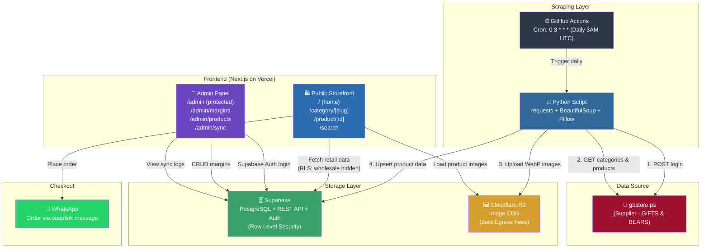
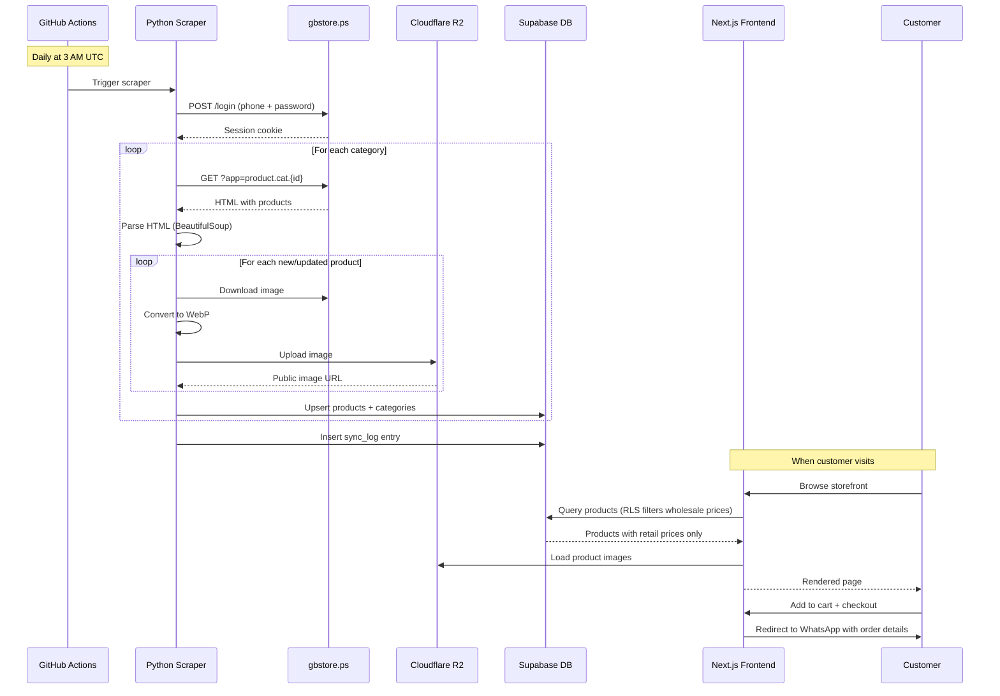
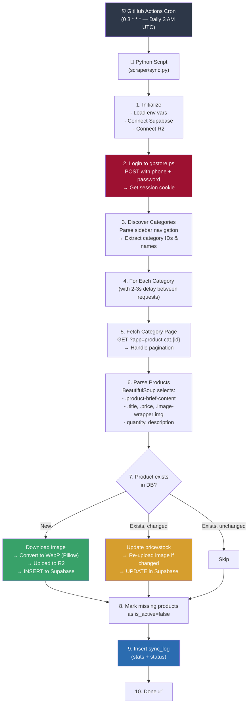
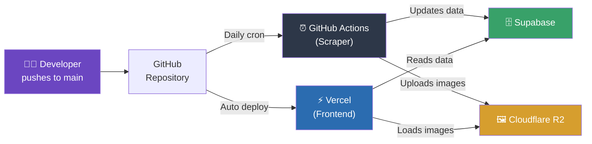

# GB Store — Complete Implementation Plan
### Custom B2B2C E-Commerce Storefront

**Date:** June 28, 2026
**Status:** ✅ Approved — Ready for Implementation

---

## Table of Contents
1. [Project Overview](#1-project-overview)
2. [Architectural Decisions](#2-architectural-decisions)
3. [Live Testing Results](#3-live-testing-results)
4. [Final Technology Stack](#4-final-technology-stack)
5. [System Architecture](#5-system-architecture)
6. [Database Schema](#6-database-schema)
7. [Scraper Design](#7-scraper-design)
8. [Frontend Structure](#8-frontend-structure)
9. [Admin Panel](#9-admin-panel)
10. [Deployment & CI/CD](#10-deployment--cicd)
11. [Cost Summary](#11-cost-summary)
12. [Implementation Phases](#12-implementation-phases)

---

## 1. Project Overview

### Business Goal
Build a custom B2B2C e-commerce storefront that:
- **Scrapes** wholesale product data (prices, images, categories, stock) from the supplier website ([gbstore.ps](https://gbstore.ps)) every 24 hours
- **Applies** dynamic category-based profit margins set by the store admin
- **Displays** only final retail prices to end-consumers (wholesale prices must remain hidden)
- **Redirects** customers to WhatsApp for checkout (no payment gateway needed)

### Core SRS Requirements
| Requirement | Description |
|---|---|
| REQ-3.1.1 | Authenticate with supplier using stored credentials |
| REQ-3.1.2 | Sync every 24 hours |
| REQ-3.1.3 | Extract: Name, Images, Description, Category, Quantity, Wholesale Price |
| REQ-3.1.4 | Compare + diff data (update/insert/deactivate) |
| REQ-3.2.1 | Admin controls for category-based markup (fixed or percentage) |
| REQ-3.2.2 | Retail price = Wholesale price + Category markup |
| REQ-3.2.3 | Margin changes apply immediately (no re-sync needed) |
| REQ-3.3.1 | Products organized by categories |
| REQ-3.3.2 | **Wholesale prices must be completely hidden from customers** |
| NFR-4.1.1 | Scraper must implement pacing delays |
| NFR-4.1.2 | Credentials stored securely |
| NFR-4.1.3 | Minimize storage overhead (reference external assets where appropriate) |

### User Roles
| Role | Access |
|---|---|
| **Customer** | Public storefront, no login required, orders via WhatsApp |
| **Admin (Store Owner)** | Protected admin panel — manage margins, monitor sync status |
| **Automated Sync** | Background scraper running on schedule |

---

## 2. Architectural Decisions

### Dilemma 1: Database vs. JSON (Serverless Approach)

**Proposal:** Build a pure frontend React app reading from a static `data.json` file.

#### Pros
- Zero hosting cost — deploy on GitHub Pages/Netlify/Vercel
- Zero database maintenance — no schema, no backups
- CDN-cached globally

#### Cons
| Risk | Severity | Detail |
|---|---|---|
| Wholesale price exposure | 🔴 Critical | JSON file is publicly accessible — **violates REQ-3.3.2** |
| No admin panel backend | 🟠 High | Can't persist margin changes without a backend |
| No real-time stock accuracy | 🟠 High | 24h stale JSON means out-of-stock products still shown |
| Client-side search limitations | 🟡 Medium | Slow full-text search over large JSON |

#### Verdict: ⛔ NOT RECOMMENDED
The JSON approach fundamentally violates the core security requirement (REQ-3.3.2). Wholesale prices in a publicly accessible JSON file are visible to anyone.

#### Chosen Solution: **Supabase** (Free PostgreSQL + REST API + Auth)
- Row Level Security (RLS) ensures wholesale prices are **never exposed** to public API queries
- Auto-generated REST API eliminates the need to build a custom backend
- Built-in auth for admin panel
- Free tier: 500MB DB, 1GB storage, 50K MAU

---

### Dilemma 2: Image Storage (Hotlinking vs. Download)

**Proposal:** Store original image URLs from `gbstore.ps` and render directly (hotlinking).

#### Pros
- Zero storage cost
- Always up-to-date images
- Zero implementation effort

#### Cons
| Risk | Severity | Detail |
|---|---|---|
| Referer-based blocking | 🔴 Critical | Supplier can block requests from your domain trivially |
| Broken images | 🔴 Critical | Supplier restructures URLs → all images break |
| Performance dependency | 🟠 High | Your store speed chained to supplier's server |
| Legal risk | 🟠 High | Consuming supplier's bandwidth without consent |
| No image optimization | 🟡 Medium | Can't serve WebP, resize for mobile, etc. |

#### Verdict: ⛔ NOT RECOMMENDED
Hotlinking creates an unacceptable single point of failure. The supplier can block it at any time with a single server rule.

#### Chosen Solution: **Cloudflare R2** (Free Image CDN)
- 10GB free storage, 10M reads/month
- **$0 egress fees** (this is the killer feature — no bandwidth charges ever)
- Scraper downloads images → converts to WebP → uploads to R2
- Full control over image pipeline, optimization, and availability

---

### Dilemma 3: Data Extraction Method

**Proposal:** Determine the most reliable, cost-effective scraping approach.

#### Option A: Browser Automation (Playwright/Selenium) — ❌ REJECTED
- Overkill — live testing proved the site is SSR with no anti-bot protections
- Higher compute cost (headless Chrome), slower, less reliable

#### Option B: HTTP Client (requests + BeautifulSoup) — ✅ CHOSEN
- Proven viable via live testing
- ~100 lines of Python, runs in <30 seconds
- Deterministic, lightweight, no rendering engine needed

#### Hosting: **GitHub Actions** (Free Cron)
- 2,000 free minutes/month
- Built-in cron scheduling, secrets management
- Zero infrastructure to maintain

---

### Dilemma 4: Frontend Framework

#### Chosen: **Next.js (App Router) on Vercel**
- Server-side rendering for SEO
- API routes can proxy Supabase calls (extra security layer)
- Free Vercel hosting with automatic deployments
- Admin panel as protected `/admin` route within the same app

---

## 3. Live Testing Results

### Target: [gbstore.ps](https://gbstore.ps) ("GIFTS & BEARS")

### Login Page Analysis


| Aspect | Finding |
|---|---|
| **CMS** | Digital Life CMS 254 (custom PHP-based) |
| **Rendering** | 100% Server-Side Rendered (SSR) |
| **URL Structure** | Query-parameter routing: `?app=product.cat.39`, `?app=product.show.3894` |
| **Login Mechanism** | Standard HTML form POST — fields: `#phone` + `#password` |
| **Session Management** | PHP cookie-based sessions (PHPSESSID-style) |
| **Anti-bot Protections** | ❌ None — no CAPTCHA, no Cloudflare, no rate-limiting |
| **Language** | Arabic (RTL), font: Almarai |
| **Form Fields** | `رقم الجوال` (Phone Number) + `كلمة المرور` (Password) |

### Price Visibility (Logged In vs. Out)


| State | What's Visible | Example |
|---|---|---|
| **Logged Out** | Retail price only | `170 ₪` |
| **Logged In** (wholesale) | Wholesale + struck-through retail | `125 ₪` wholesale, ~~`170 ₪`~~ retail |

- Products tagged with **"جملة"** (wholesale) badge when logged in
- Both prices are in the DOM and trivially extractable via CSS selectors

### Key DOM Structure Observations
- **Product cards:** `.product-brief-content` containers
- **Product titles:** `.title` or `.title h2` within product cards
- **Price elements:** `.price` with nested `<del>` for original and text for wholesale
- **Images:** `.image-wrapper img` with `src` pointing to `/upload/...` paths
- **Categories:** Sidebar navigation with links to `?app=product.cat.{id}`
- **Pagination:** Standard page links if category has many products

### Scraping Feasibility: ✅ CONFIRMED
```python
# This approach is PROVEN VIABLE from live testing:
import requests
from bs4 import BeautifulSoup

session = requests.Session()
session.post('https://gbstore.ps/?account=login', data={
    'phone': '0595809023',
    'password': '112211'
})

# All product data is in the HTML — no JS needed
response = session.get('https://gbstore.ps/?app=product.cat.39')
soup = BeautifulSoup(response.text, 'html.parser')
products = soup.select('.product-brief-content')
```

---

## 4. Final Technology Stack

| Layer | Technology | Cost | Purpose |
|---|---|---|---|
| **Frontend** | Next.js 15 (App Router) | $0 (Vercel free) | Storefront + Admin panel |
| **Database** | Supabase (PostgreSQL) | $0 (free tier) | Products, categories, margins, auth |
| **Image CDN** | Cloudflare R2 | $0 (free tier) | Optimized product images (WebP) |
| **Scraper** | Python (requests + BeautifulSoup) | $0 | Data extraction from supplier |
| **Scraper Host** | GitHub Actions | $0 (free tier) | Daily cron job execution |
| **Auth** | Supabase Auth | $0 (included) | Admin panel authentication |
| **Checkout** | WhatsApp deeplink | $0 | Order submission via WhatsApp message |
| **Version Control** | GitHub | $0 | Source code + CI/CD |

---

## 5. System Architecture



### Data Flow — Step by Step



---

## 6. Database Schema

### Tables

#### `categories`
```sql
CREATE TABLE categories (
    id UUID DEFAULT gen_random_uuid() PRIMARY KEY,
    supplier_id TEXT UNIQUE NOT NULL,       -- Original ID from gbstore.ps (e.g., "39")
    name TEXT NOT NULL,                      -- Arabic category name
    slug TEXT UNIQUE NOT NULL,               -- URL-friendly slug
    image_url TEXT,                           -- R2 image URL
    parent_id UUID REFERENCES categories(id),-- For sub-categories
    sort_order INT DEFAULT 0,
    is_active BOOLEAN DEFAULT true,
    created_at TIMESTAMPTZ DEFAULT now(),
    updated_at TIMESTAMPTZ DEFAULT now()
);
```

#### `products`
```sql
CREATE TABLE products (
    id UUID DEFAULT gen_random_uuid() PRIMARY KEY,
    supplier_id TEXT UNIQUE NOT NULL,        -- Original product ID from supplier
    category_id UUID REFERENCES categories(id),
    name TEXT NOT NULL,
    slug TEXT UNIQUE NOT NULL,
    description TEXT,
    wholesale_price DECIMAL(10,2) NOT NULL,  -- 🔒 HIDDEN via RLS
    image_url TEXT,                           -- R2 CDN URL (WebP)
    additional_images TEXT[],                 -- Array of R2 URLs
    supplier_image_url TEXT,                  -- Original URL for reference
    quantity INT DEFAULT 0,
    is_available BOOLEAN DEFAULT true,
    is_active BOOLEAN DEFAULT true,          -- Admin can deactivate
    tags TEXT[],                              -- "جملة", "حصرياً", etc.
    created_at TIMESTAMPTZ DEFAULT now(),
    updated_at TIMESTAMPTZ DEFAULT now()
);
```

#### `margins`
```sql
CREATE TABLE margins (
    id UUID DEFAULT gen_random_uuid() PRIMARY KEY,
    category_id UUID REFERENCES categories(id) UNIQUE NOT NULL,
    margin_type TEXT NOT NULL CHECK (margin_type IN ('percentage', 'fixed')),
    margin_value DECIMAL(10,2) NOT NULL,     -- e.g., 15.00 for 15% or 20.00 for ₪20
    created_at TIMESTAMPTZ DEFAULT now(),
    updated_at TIMESTAMPTZ DEFAULT now()
);
```

#### `sync_logs`
```sql
CREATE TABLE sync_logs (
    id UUID DEFAULT gen_random_uuid() PRIMARY KEY,
    started_at TIMESTAMPTZ NOT NULL,
    completed_at TIMESTAMPTZ,
    status TEXT NOT NULL CHECK (status IN ('running', 'success', 'failed')),
    products_added INT DEFAULT 0,
    products_updated INT DEFAULT 0,
    products_deactivated INT DEFAULT 0,
    categories_found INT DEFAULT 0,
    error_message TEXT,
    created_at TIMESTAMPTZ DEFAULT now()
);
```

### Database View — Retail Products (Public API)
```sql
-- This view computes retail prices and NEVER exposes wholesale_price
CREATE VIEW public_products AS
SELECT
    p.id,
    p.name,
    p.slug,
    p.description,
    p.image_url,
    p.additional_images,
    p.quantity,
    p.is_available,
    p.tags,
    c.name AS category_name,
    c.slug AS category_slug,
    c.id AS category_id,
    CASE
        WHEN m.margin_type = 'percentage'
            THEN ROUND(p.wholesale_price * (1 + m.margin_value / 100), 2)
        WHEN m.margin_type = 'fixed'
            THEN p.wholesale_price + m.margin_value
        ELSE p.wholesale_price  -- fallback if no margin set
    END AS retail_price,
    p.updated_at
FROM products p
JOIN categories c ON p.category_id = c.id
LEFT JOIN margins m ON c.id = m.category_id
WHERE p.is_active = true AND c.is_active = true;
```

### Row Level Security (RLS)
```sql
-- Enable RLS on products table
ALTER TABLE products ENABLE ROW LEVEL SECURITY;

-- Public users can ONLY read via the public_products view (no wholesale_price)
CREATE POLICY "Public read products" ON products
    FOR SELECT TO anon
    USING (is_active = true);

-- But the anon role CANNOT see wholesale_price column directly
-- Enforce this by granting SELECT only on specific columns:
REVOKE ALL ON products FROM anon;
GRANT SELECT (id, name, slug, description, image_url, additional_images,
              quantity, is_available, is_active, tags, category_id,
              created_at, updated_at) ON products TO anon;

-- Admin (authenticated) can see everything including wholesale_price
CREATE POLICY "Admin full access" ON products
    FOR ALL TO authenticated
    USING (true)
    WITH CHECK (true);

-- Margins: only admin can read/write
ALTER TABLE margins ENABLE ROW LEVEL SECURITY;
CREATE POLICY "Admin manage margins" ON margins
    FOR ALL TO authenticated
    USING (true) WITH CHECK (true);

-- Sync logs: only admin can read, scraper writes via service_role key
ALTER TABLE sync_logs ENABLE ROW LEVEL SECURITY;
CREATE POLICY "Admin read sync logs" ON sync_logs
    FOR SELECT TO authenticated
    USING (true);
```

---

## 7. Scraper Design

### Architecture



### Project Structure — Scraper
```
scraper/
├── sync.py              # Main entry point
├── auth.py              # Login session management
├── extractor.py         # HTML parsing (categories + products)
├── image_pipeline.py    # Download → WebP → R2 upload
├── db.py                # Supabase upsert logic
├── config.py            # Environment variable loader
├── requirements.txt     # requests, beautifulsoup4, pillow, supabase, boto3
└── README.md            # Setup instructions
```

### Key Implementation Details

1. **Pacing (NFR-4.1.1):** `time.sleep(random.uniform(2, 4))` between requests
2. **Credentials (NFR-4.1.2):** Stored as GitHub Actions encrypted secrets
3. **Image Optimization:** Pillow converts to WebP at 80% quality (~60-70% size reduction)
4. **Diff Logic:** Compare `wholesale_price`, `quantity`, `name` against existing DB records
5. **Error Handling:** Try/except per product, continue on failure, log errors in `sync_logs`
6. **Deactivation:** Products in DB but not in latest scrape → `is_active = false`

### GitHub Actions Workflow
```yaml
# .github/workflows/scrape.yml
name: Daily Product Sync
on:
  schedule:
    - cron: '0 3 * * *'      # Daily at 3 AM UTC
  workflow_dispatch:            # Manual trigger button

jobs:
  sync:
    runs-on: ubuntu-latest
    timeout-minutes: 30
    steps:
      - uses: actions/checkout@v4
      - uses: actions/setup-python@v5
        with:
          python-version: '3.12'

      - name: Install dependencies
        run: pip install -r scraper/requirements.txt

      - name: Run product sync
        run: python scraper/sync.py
        env:
          SUPPLIER_PHONE: ${{ secrets.SUPPLIER_PHONE }}
          SUPPLIER_PASSWORD: ${{ secrets.SUPPLIER_PASSWORD }}
          SUPABASE_URL: ${{ secrets.SUPABASE_URL }}
          SUPABASE_SERVICE_KEY: ${{ secrets.SUPABASE_SERVICE_KEY }}
          R2_ENDPOINT: ${{ secrets.R2_ENDPOINT }}
          R2_ACCESS_KEY: ${{ secrets.R2_ACCESS_KEY }}
          R2_SECRET_KEY: ${{ secrets.R2_SECRET_KEY }}
          R2_BUCKET: ${{ secrets.R2_BUCKET }}
```

---

## 8. Frontend Structure

### Next.js App Router Structure
```
src/
├── app/
│   ├── layout.js              # Root layout (RTL, Arabic font, global nav)
│   ├── page.js                # Homepage — hero + featured categories + new products
│   ├── globals.css            # Design system (CSS variables, typography, components)
│   │
│   ├── category/
│   │   └── [slug]/
│   │       └── page.js        # Category listing — product grid + filters + sort
│   │
│   ├── product/
│   │   └── [slug]/
│   │       └── page.js        # Product detail — images, description, price, WhatsApp CTA
│   │
│   ├── search/
│   │   └── page.js            # Search results page
│   │
│   ├── admin/
│   │   ├── layout.js          # Admin layout (auth guard, sidebar nav)
│   │   ├── page.js            # Dashboard — sync status, product counts, quick stats
│   │   ├── margins/
│   │   │   └── page.js        # Category margin management (table + inline edit)
│   │   ├── products/
│   │   │   └── page.js        # Product overview (wholesale + retail prices visible)
│   │   └── login/
│   │       └── page.js        # Admin login page
│   │
│   └── api/                   # API routes (optional middleware)
│       └── ...
│
├── components/
│   ├── layout/
│   │   ├── Header.jsx         # Site header with logo, search, nav
│   │   ├── Footer.jsx         # Site footer
│   │   ├── Sidebar.jsx        # Category sidebar navigation
│   │   └── MobileNav.jsx      # Mobile hamburger menu
│   │
│   ├── product/
│   │   ├── ProductCard.jsx    # Product card for grid listings
│   │   ├── ProductGrid.jsx    # Responsive product grid
│   │   ├── ProductDetail.jsx  # Full product detail view
│   │   └── PriceTag.jsx       # Formatted price display (₪)
│   │
│   ├── category/
│   │   ├── CategoryCard.jsx   # Category card for homepage grid
│   │   └── CategoryGrid.jsx   # Category grid layout
│   │
│   ├── checkout/
│   │   └── WhatsAppButton.jsx # WhatsApp order CTA with pre-filled message
│   │
│   ├── search/
│   │   ├── SearchBar.jsx      # Header search input
│   │   └── SearchResults.jsx  # Search results display
│   │
│   └── ui/
│       ├── LoadingSpinner.jsx
│       ├── Badge.jsx
│       ├── EmptyState.jsx
│       └── Breadcrumb.jsx
│
├── lib/
│   ├── supabase.js            # Supabase client initialization
│   ├── supabase-server.js     # Server-side Supabase client
│   ├── utils.js               # Helpers (slug generation, price formatting)
│   └── whatsapp.js            # WhatsApp deeplink generator
│
└── public/
    ├── fonts/                 # Almarai font (self-hosted)
    └── icons/                 # Favicons, PWA icons
```

### Design System Highlights
- **Direction:** RTL (Arabic-first)
- **Typography:** Almarai (Google Fonts, self-hosted for performance)
- **Color Palette:** Premium dark theme with the supplier's accent (#9d1131 crimson) reimagined
- **Animations:** Subtle micro-animations on cards, hover effects, page transitions
- **Responsive:** Mobile-first, 3 breakpoints (mobile, tablet, desktop)
- **Accessibility:** Semantic HTML5, proper heading hierarchy, alt text on images

### WhatsApp Checkout Flow
```
Customer adds items → Cart summary displayed →
Click "اطلب عبر واتساب" (Order via WhatsApp) →
Opens WhatsApp with pre-filled message:

"مرحباً، أريد طلب المنتجات التالية:
1. شنطة FENDI × 1 — 130 ₪
2. عطر CK × 2 — 90 ₪
المجموع: 310 ₪
شكراً!"
```

---

## 9. Admin Panel

### Features
| Feature | Route | Description |
|---|---|---|
| **Login** | `/admin/login` | Supabase Auth (email/password) |
| **Dashboard** | `/admin` | Last sync time, product counts, error alerts |
| **Margins** | `/admin/margins` | Table of categories with inline margin editing |
| **Products** | `/admin/products` | Full product table showing wholesale + retail + margin |
| **Sync Logs** | `/admin` (dashboard widget) | History of sync runs with status and stats |

### Margin Management UI
```
┌─────────────────────────────────────────────────────────────┐
│  Category Margins                                    [Save All] │
├──────────────────┬──────────┬──────────┬──────────────────┤
│ Category         │ Type     │ Value    │ Example          │
├──────────────────┼──────────┼──────────┼──────────────────┤
│ شنط و جزادين    │ [% ▼]    │ [15    ] │ 100₪ → 115₪    │
│ عطور            │ [Fixed ▼]│ [20    ] │ 70₪ → 90₪      │
│ ساعات ستاتية    │ [% ▼]    │ [25    ] │ 200₪ → 250₪    │
│ اكسسوار         │ [% ▼]    │ [10    ] │ 50₪ → 55₪      │
└──────────────────┴──────────┴──────────┴──────────────────┘
```

### Auth Protection
- Supabase Auth with email/password (admin creates their account once)
- Next.js middleware checks auth state on all `/admin/*` routes
- Redirects to `/admin/login` if not authenticated
- Service role key used ONLY by the scraper (server-side, never exposed)

---

## 10. Deployment & CI/CD

### GitHub Repository Structure
```
custom-store/
├── .github/
│   └── workflows/
│       └── scrape.yml         # Daily cron scraper
│
├── scraper/                   # Python scraper (separate from frontend)
│   ├── sync.py
│   ├── auth.py
│   ├── extractor.py
│   ├── image_pipeline.py
│   ├── db.py
│   ├── config.py
│   └── requirements.txt
│
├── src/                       # Next.js frontend
│   ├── app/
│   ├── components/
│   ├── lib/
│   └── ...
│
├── public/
├── supabase/
│   └── migrations/
│       └── 001_initial_schema.sql
│
├── .env.local.example         # Template for local dev
├── next.config.js
├── package.json
├── srs.md                     # Original requirements
└── README.md
```

### Deployment Flow


### Required Secrets (GitHub Actions)
| Secret Name | Description |
|---|---|
| `SUPPLIER_PHONE` | gbstore.ps login phone number |
| `SUPPLIER_PASSWORD` | gbstore.ps login password |
| `SUPABASE_URL` | Supabase project URL |
| `SUPABASE_SERVICE_KEY` | Supabase service_role key (full access) |
| `R2_ENDPOINT` | Cloudflare R2 S3-compatible endpoint |
| `R2_ACCESS_KEY` | R2 API access key |
| `R2_SECRET_KEY` | R2 API secret key |
| `R2_BUCKET` | R2 bucket name |

### Environment Variables (Next.js / Vercel)
| Variable | Description | Exposed to Client? |
|---|---|---|
| `NEXT_PUBLIC_SUPABASE_URL` | Supabase project URL | ✅ Yes (public) |
| `NEXT_PUBLIC_SUPABASE_ANON_KEY` | Supabase anon key (RLS-protected) | ✅ Yes (safe with RLS) |
| `SUPABASE_SERVICE_KEY` | Service role key | ❌ Server-only |

---

## 11. Cost Summary

| Component | Service | Monthly Cost |
|---|---|---|
| Frontend Hosting | Vercel Free Tier | **$0** |
| Database + API + Auth | Supabase Free Tier (500MB DB, 50K MAU) | **$0** |
| Image Storage + CDN | Cloudflare R2 Free Tier (10GB, 0 egress) | **$0** |
| Scraper Execution | GitHub Actions Free Tier (2,000 min/mo) | **$0** |
| Domain Name | Custom domain (optional) | **~$10/year** |
| **TOTAL** | | **$0/month** |

### Free Tier Limits vs. Expected Usage

| Resource | Free Limit | Expected Usage | Headroom |
|---|---|---|---|
| Supabase DB | 500 MB | ~50-100 MB (est. 1-2K products) | ✅ 5-10x |
| Supabase MAU | 50,000 | ~100-500 (small user base) | ✅ 100x+ |
| R2 Storage | 10 GB | ~1-3 GB (est. 1-2K images in WebP) | ✅ 3-10x |
| R2 Reads | 10M/month | ~50-200K (small user base) | ✅ 50x+ |
| GitHub Actions | 2,000 min/mo | ~15-30 min/mo (1 daily run) | ✅ 66x+ |
| Vercel Bandwidth | 100 GB/mo | ~5-20 GB (small user base) | ✅ 5-20x |

---

## 12. Implementation Phases

### Phase 1: Foundation (Days 1-2)
- [ ] Initialize Next.js project with App Router
- [ ] Set up Supabase project (create account, project, get keys)
- [ ] Set up Cloudflare R2 bucket
- [ ] Create GitHub repository with secrets
- [ ] Run SQL migration to create tables, views, and RLS policies
- [ ] Configure environment variables

### Phase 2: Scraper (Days 3-5)
- [ ] Build login + session management (`auth.py`)
- [ ] Build category discovery (`extractor.py`)
- [ ] Build product extraction with pagination (`extractor.py`)
- [ ] Build image pipeline: download → WebP → R2 upload (`image_pipeline.py`)
- [ ] Build Supabase upsert logic with diff (`db.py`)
- [ ] Add pacing, error handling, logging
- [ ] Create GitHub Actions workflow
- [ ] Run first full sync manually
- [ ] Verify data in Supabase dashboard

### Phase 3: Storefront (Days 6-10)
- [ ] Design system — CSS variables, typography, RTL layout
- [ ] Layout shell — header, sidebar, footer, mobile nav
- [ ] Homepage — hero banner, category grid, featured products
- [ ] Category page — product grid, sorting, pagination
- [ ] Product detail page — images, description, price, WhatsApp CTA
- [ ] Search functionality
- [ ] Cart + WhatsApp checkout flow
- [ ] Mobile responsive polish
- [ ] Micro-animations and premium design touches

### Phase 4: Admin Panel (Days 11-13)
- [ ] Admin login page (Supabase Auth)
- [ ] Auth middleware for `/admin/*` routes
- [ ] Dashboard — sync status, product counts, alerts
- [ ] Category margin management (inline table editor)
- [ ] Product overview (with wholesale + retail price visibility)

### Phase 5: Polish & Deploy (Days 14-15)
- [ ] End-to-end testing
- [ ] SEO optimization (meta tags, OG images, sitemap)
- [ ] Performance audit (Lighthouse, Core Web Vitals)
- [ ] Deploy to Vercel
- [ ] Connect custom domain (if applicable)
- [ ] Final GitHub Actions cron test
- [ ] Handoff documentation

### Estimated Total: ~15 working days

---

> [!NOTE]
> This implementation plan is a living document. It will be updated as decisions are made and the project progresses. All architectural decisions documented here have been approved by the stakeholder.
